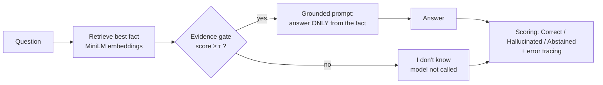

# Knowing When Not to Answer: An Evidence Gate for Reducing LLM Hallucination

> Measuring and mitigating hallucination in a small open LLM: baseline vs. retrieval-grounded answers across question categories.

Large language models often answer questions they cannot answer, producing fluent, confident and **invented** facts. This project measures how often a small open model (Qwen2.5-1.5B-Instruct) hallucinates across four kinds of questions, and tests a lightweight fix: **retrieve a trusted fact, refuse when the evidence is too weak, and otherwise answer only from that fact.**

*Seminar on AI · 2026* · Status: 🟡 system built and run, human labeling in progress

---

## Highlights

- **New logic: an evidence gate.** Before the model is called, the best-matching fact is scored against the question. Below a threshold τ, the system answers *"I don't know"* without calling the model.
- **Fair threshold.** τ = 0.588 was set once on a separate 10-question pilot and frozen before the real run.
- **Per-category evaluation** on 100 questions: popular facts, rare facts, fabricated entities, numbers and dates.
- **Three outcomes, not one.** Hallucination rate, abstention rate and accuracy are always reported together, so refusing everything cannot look like success.
- **Error tracing.** Every grounded hallucination is tagged as a retrieval error, a generation error or a gate miss.
- **Live demo** (Gradio): baseline and grounded answers side by side.

## How it works



The **baseline** sends the same question straight to the model with a plain prompt, so the only difference between the two conditions is the method.

## Preliminary results

Automatic text-matching check on the 100 test questions. **Two-person human labeling is in progress**; these numbers will be replaced by the confirmed rates.

| Category (25 questions each) | Baseline: hallucinated | Evidence gate + grounding: hallucinated |
|---|---|---|
| Popular facts | 1 | 0 |
| Rare (long-tail) facts | 5 | 0 |
| Fabricated entities | 9 | 0 |
| Numbers and dates | 0 | 0 |
| **Total** | **15 / 100** | **0 / 100** |

The gate blocked **25 / 25** fabricated questions and passed **75 / 75** real ones. On the pilot set, real questions scored ≥ 0.745 and fabricated ones ≤ 0.431.

**Example baseline hallucinations**

| Question | Baseline answer | Grounded system |
|---|---|---|
| Explain the Hallstrom effect in superconductors. *(does not exist)* | Invents the effect, a Swedish physicist "Bengt Hallström" and a year (1957) | Blocked: "I don't know." |
| Who wrote *The Master and Margarita*? | Dmitri Shostakovich | Mikhail Bulgakov |
| Which composer wrote the opera *Rusalka*? | Bedřich Smetana | Antonín Dvořák |
| Which is the closest star to Earth? | Proxima Centauri | The Sun |

### Limitations

- **Easy retrieval setting:** every real question has its exact fact in the fact base. A harder test that removes each question's own fact is planned.
- **Closed knowledge:** the system only knows its 82 facts, so real questions outside them are refused.
- **One small model:** results describe Qwen2.5-1.5B-Instruct and may not generalize to larger models.

## Run it yourself

The notebook runs on free **Google Colab** with a T4 GPU.

1. Create a folder `AI_Hallucination` in your Google Drive and copy `dataset.csv` into it.
2. Open `hallucination_pipeline.ipynb` in Colab and set **Runtime → Change runtime type → T4 GPU**.
3. Run the parts in order: setup → baseline → labeling sheet → fact base and pilot → grounded run → results.
4. For the demo only, run the **Quick Start** cell; it prints a public `gradio.live` link.

Every answer is saved to Drive as soon as it is generated, so a disconnect never loses work.

## Dataset

`dataset.csv` contains 110 questions: 100 test questions (25 per category) and 10 pilot questions used only to set τ. Each real question has a gold answer, accepted aliases, a Wikipedia source link and one fact sentence for the fact base. The fabricated questions describe people, papers, places and events invented by the authors.

## Project structure

```
├── dataset.csv                     # 110 questions with answers, sources and facts
├── hallucination_pipeline.ipynb    # full experiment + live demo
├── results/
│   ├── baseline_results.csv        # every baseline answer
│   └── grounded_results.csv        # every grounded answer, with fact, score and gate decision
└── requirements.txt
```

## Tech stack

Python · PyTorch · Hugging Face Transformers · Sentence-Transformers · pandas · scikit-learn · Gradio · Google Colab

## Roadmap

- [x] Proposal, literature review and system design
- [x] Baseline run on 100 questions
- [x] Fact base, pilot and evidence gate (τ = 0.588)
- [x] Grounded run and live demo
- [ ] Two-person labeling and inter-annotator agreement
- [ ] Harder test: remove each question's own fact from the fact base
- [ ] Demo v0.6: verdicts and a results tab
- [ ] Final report

## References

- Huang, L. et al. (2025). A Survey on Hallucination in Large Language Models. *ACM Transactions on Information Systems*, 43(2).
- AboulEla, S. et al. (2025). Exploring RAG Solutions to Reduce Hallucinations in LLMs. *IEEE SysCon 2025*.
- Ding, H. et al. (2025). Rowen: Adaptive Retrieval-Augmented Generation for Hallucination Mitigation in LLMs. *ACM SIGIR-AP 2025*.
- Malin, B., Kalganova, T., & Boulgouris, N. (2025). A Review of Faithfulness Metrics for Hallucination Assessment in Large Language Models. *IEEE JSTSP*, 19(7).
- Correctness is not Faithfulness in Retrieval Augmented Generation Attributions (2025). *ACM ICTIR 2025*.
- Numerical Hallucinations in Retrieval-Augmented Generation: Detection and Analysis (2026). *ACM SIGIR 2026*.
- Lewis, P. et al. (2020). Retrieval-Augmented Generation for Knowledge-Intensive NLP Tasks. *NeurIPS*.

## Authors

- **[Your Full Name]** ([@kessneyedor](https://github.com/kessneyedor)): main author; system design, implementation and experiments
- **Smriti Tamang**: co-author; evaluation and labeling

Developed for the Seminar on AI, 2026.

## License

Code: MIT. Fact sentences are paraphrased from Wikipedia (CC BY-SA 4.0); each source is linked in the dataset.
